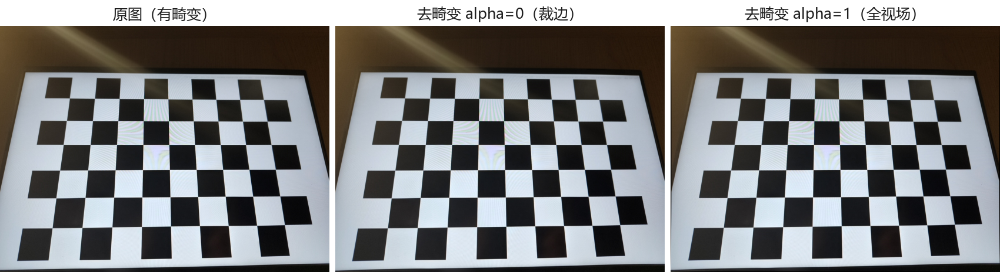
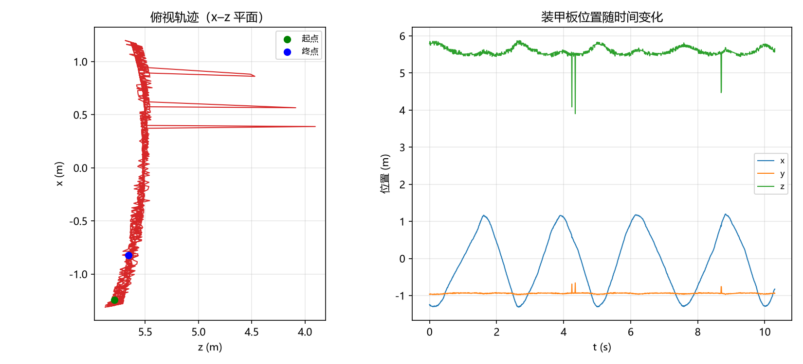
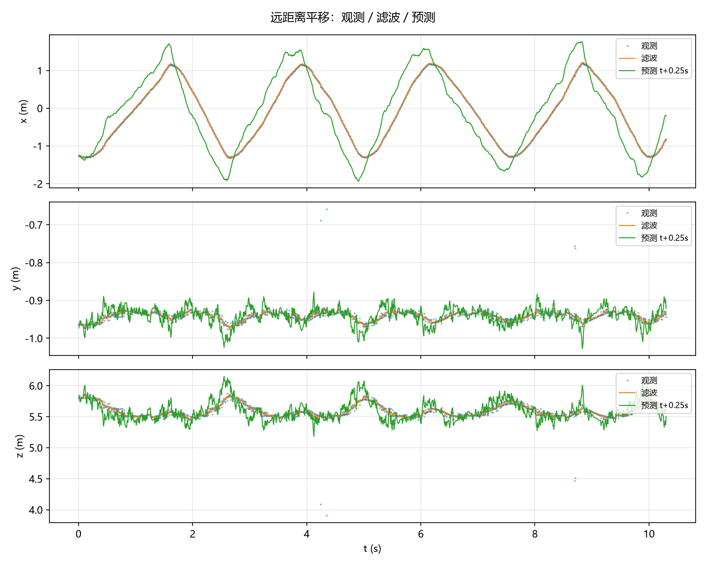
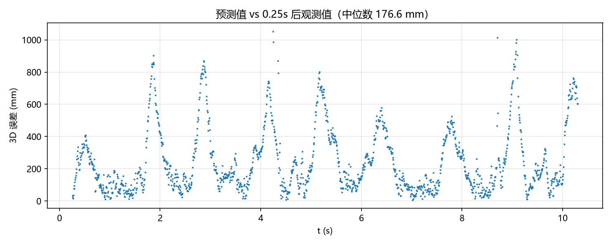

# MountainForge 战队视觉组 2027 赛季招新考核 — 设计报告

## 0. 基本信息

| 项目      | 内容                                                                               |
| ------- | -------------------------------------------------------------------------------- |
| 姓名      | 鲍仁杰                                                                              |
| 学校 / 专业 | 浙江科技大学 / 人工智能                                                                     |
| 考核时间    | 2026.10.16 – 2026.10.19                                                          |
| 仓库地址    | https://github.com/brj-boss/rm-vision-recruit-brj                                     |
| 所选方向题   | **A 题　装甲板识别与运动预测**                                                               |
| 运行环境    | Python 3.12（`.venv`）+ NumPy / OpenCV / Matplotlib / PyYAML，详见 `requirements.txt` |

### 如何运行本仓库代码

```bash
# 1. 建环境（需要 uv 或 python 3.10+）
uv venv --python 3.12 --seed .venv
.venv\Scripts\activate

# 2. 装依赖
pip install -r requirements.txt

# 3. 放置原始素材
#    考核包中的 data/ 目录请放到本仓库根目录下（该目录已加入 .gitignore，未入库）

# 4. 运行（示例，按实际文件名调整）
python q2_calib/calibrate.py
python qA_aim/detect.py
```

> 说明：原始素材 `data/`（实拍视频、点云等）体积较大，且由考核包统一提供，故未纳入版本库。  
> 代码中一律使用相对路径 `data/...`，把 `data/` 放回仓库根目录即可直接运行。

---

## 1. 完成情况一览

| 题目                       | 基本要求         | 发挥部分            | 备注                          |
| ------------------------ | ------------ | --------------- | --------------------------- |
| 题一　开发环境与工程规范             | ✅ 完成         | ✅ 完成（WSL2 Ubuntu 24.04） | Python 3.12 环境 + Git 仓库     |
| 题二　相机标定与单目测距             | ✅ 标定完成，测距待拍图 | ⬜               | 标定定稿 k3fix，RMS 0.406px      |
| A 题　装甲板识别与运动预测           | ✅ 完成         | ✅ 完成（小陀螺 + Q/R） | 4 段视频识别 + PnP + 卡尔曼预测 + 小陀螺 |
| 附加题一　PyTorch + ONNX 分类网络 | —            | ⬜ 未做            |                             |
| 附加题二　ARM/x86、NPU/GPU 比较  | —            | ⬜ 未做            |                             |
| 附加题三　自瞄命中率论述             | —            | ⬜ 未做            |                             |
| 附加题四　开源项目评述              | —            | ⬜ 未做            |                             |

---

## 2. 题一　开发环境与工程规范

### 2.1 环境搭建

| 组件            | 版本                      |
| ------------- | ----------------------- |
| Python        | 3.12.14（项目 `.venv`）     |
| numpy         | 2.5.4                   |
| opencv-python | 5.0.0.93                |
| matplotlib    | 3.11.2                  |
| PyYAML        | 6.0.3                   |
| Git           | 已配置（含 GitHub 代理）        |
| 操作系统          | Windows 11（Build 26200） |

安装命令：

```bash
uv venv --python 3.12 --seed .venv
.venv\Scripts\python.exe -m pip install -r requirements.txt
```

验证方式（截图见 `q1_env/screenshots/`）：

```bash
.venv\Scripts\python.exe -c "import numpy, cv2, matplotlib, yaml; print('OK')"
```

### 2.2 仓库结构

```
rm-vision-recruit-brj/
├── README.md            本设计报告
├── ai_log.md            AI 使用记录
├── requirements.txt     依赖清单
├── q1_env/              题一：环境与工程规范
├── q2_calib/            题二：相机标定与单目测距
├── qA_aim/              A 题：装甲板识别与运动预测
└── extra/               附加题
```

### 2.3 发挥部分：Linux 环境与基本命令

**已完成（WSL2 + Ubuntu 24.04）**。选择 WSL2：Windows 11 原生支持，免装虚拟机软件、免双系统重启切换。

| 项 | 值 |
|---|---|
| 发行版 | Ubuntu 24.04.5 LTS |
| 内核 | 6.18.54.1-microsoft-standard-WSL2 |
| 用户 | brj（非 root） |

三条验证命令 `ls -la`、`top -n 1`、`cat /proc/cpuinfo | head` 均已执行并截图，详见 [`q1_env/README.md` 第 7 节](q1_env/README.md#7-发挥部分linux-环境wsl2--ubuntu-2404)与 `q1_env/screenshots/ubuntu/`。

---

## 3. 题二　相机标定与单目测距

### 3.1 方案

待填：棋盘格制作方式、方格实测边长、采集方式、标定流程。

### 3.2 标定结果

- 图像尺寸：1600 × 1200（手机主摄，24 张）
- 方格边长：**25.0 mm**（屏幕方案直尺实测，见 `q2_calib/README.md` 实测记录）
- 内参矩阵 K：
  ```
  [[1140.12,    0,  803.02],
   [   0,  1142.33, 599.37],
   [   0,      0,      1]]
  ```
- 畸变系数（k3fix 模型）：`[0.0302, -0.0389, 0, 0, 0]`
- 重投影误差 RMS：**0.4057 px**（< 0.5，很好档）

> 关于畸变系数接近 0 的说明：手机主摄在出厂时 ISP 已做几何矫正，真实畸变本身趋近 0（详见 `q2_calib/README.md`）。`undistort.py` 用直线度检验（角点偏离拟合直线 0.954 → 0.670 px，降 30%）在数值上证明了畸变虽小但真实存在、被正确修正。

### 3.3 去畸变前后对比



### 3.4 单目测距（PnP）

采用 solvePnP(IPPE) 解算，目标纸尺寸实测 **230 × 285 mm**，俯拍（纸平铺深色背景 + 卷尺入镜）。

| 序号 | 实测距离 (m) | 计算距离 (m) | 误差 (mm) | 相对误差 |
| -- | -------- | -------- | ------ | ---- |
| 1  | 0.500    | 0.476    | −23.8  | −4.77% |
| 2  | 0.900    | 0.908    | +8.4   | +0.93% |
| 3  | 1.100    | 1.124    | +23.7  | +2.16% |
| 4  | 1.300    | 1.292    | −7.7   | −0.59% |

> 结果图见 `q2_calib/q2_figs/measure_check.png`。除第 1 组（近距离俯拍相机轻微倾斜导致 4.8%）外，其余三组相对误差均在 2.2% 以内。`measure.py --selftest` 合成自检 500~3000 mm 最大误差 0.04%，说明链路正确，真实误差主要来自手拍姿态与卷尺读数。

### 3.5 发挥部分

- **角度影响**：待填（正对 / 斜 30° / 斜 60° 的误差对比）
- **误差曲线**：待填（图见 `q2_calib/q2_figs/`）
- **误差来源分析（≥3 项）**：待填
- **对比实验**：
  - ① 仅用 5 张标定图 → 待填
  - ② 全部正对拍摄 → 待填
  - ③ 方格边长输错（25 mm 输成 20 mm）→ 待填

### 3.6 问题回答

- [ ] ① 内参矩阵中各参数的物理含义是什么？fx 与 fy 为何接近？
- [ ] ② 重投影误差衡量的是什么？

---

## 4. A 题　装甲板识别与运动预测

### 4.1 整体流程

```
相机图像
  → 灰度化 + 亮度阈值分割（暗场下灯条是唯一高亮目标）
  → findContours 提取亮斑 → 几何过滤出「灯条」（竖直细长条）
  → 灯条两两配对成装甲板（长度比/倾角差/顶端对齐/中心距比例）
  → 4 关键点（左灯上 → 左灯下 → 右灯下 → 右灯上）
  → solvePnP(IPPE) 解算 (x, y, z, yaw)
  → 匀速卡尔曼滤波 → 外推 t + 0.25 s 位置
```

### 4.2 装甲板识别

**预处理**：BGR → 灰度；不做颜色分割，因为红蓝双方灯条在灰度上都是高亮，且视频均为暗场（画面 P99 亮度仅 28~58），用单一亮度阈值即可把灯条与背景干净分离。`装甲板_蓝.mp4` 因整体更暗（P99≈28），单独用更低的阈值（60）。

**灯条筛选判据**（`find_lights`）：

| 判据              | 阈值                        | 设计依据             |
| --------------- | ------------------------- | ---------------- |
| 亮度阈值 `v_min`    | 170（蓝方视频 60）              | 灯条发光亮度远高于背景      |
| 最小面积 `area_min` | 6（蓝方 3）                   | 滤掉噪点、小反光         |
| 长宽比 `ratio_min` | 3.0                       | 灯条是细长竖直条，区别于圆形光斑 |
| 长边方向            | 接近竖直（minAreaRect 角度 >45°） | 排除水平亮条（如窗帘漏光）    |

**灯条配对判据**（`match_lights`）：

| 判据                 | 阈值             | 设计依据         |
| ------------------ | -------------- | ------------ |
| 长度比 ≥0.7           | 两灯条等长          | 同一装甲板两灯条物理等长 |
| 倾角差 ≤12°           | 两灯条平行          | 同一装甲板两灯条同向   |
| 顶端高度差 ≤0.5×灯条长     | 顶端大致齐平         | 跨板配对顶端错位大    |
| 连线倾角 ≤35°          | 两灯条连线近水平       | 装甲板横置        |
| 中心距/灯条长 ∈[1.5,4.5] | 真值 135/55≈2.45 | 过滤错误组合       |

**关键点顺序**：左灯条上端 → 左灯条下端 → 右灯条下端 → 右灯条上端（逆时针），与 PnP 的 3D 点一一对应。

识别结果视频（标出四边形与关键点顺序）：

| 视频    | 文件                                        |
| ----- | ----------------------------------------- |
| 远距离平移 | `qA_aim/figures/detect_far_trans.mp4`     |
| 中距离陀螺 | `qA_aim/figures/detect_mid_spin.mp4`      |
| 近距离陀螺 | `qA_aim/figures/detect_near_spin.mp4`     |
| 装甲板_蓝 | `qA_aim/figures/detect_blue.mp4`（仅识别，无位姿） |

### 4.3 位姿解算

- 相机参数：`data/armor/camera_info.json`（8 mm 镜头，1440×1080，fx≈2320）
- 装甲板参数：灯条长 55 mm，两灯条中心距 135 mm；3D 点原点设在装甲板几何中心
- 坐标系：相机坐标系，x 右、y 下、z 前，单位 m
- 解算：`cv2.solvePnP` + `SOLVEPNP_IPPE`（专用于共面点，比通用 PnP 更稳）
- 结果：`qA_aim/detections_远距离平移.csv` 等

位置随时间曲线与俯视轨迹：





### 4.4 运动预测（卡尔曼滤波）

- **状态量**：`[x, y, z, vx, vy, vz]`（匀速 CV 模型，6 维）
- **状态转移**：`F[0,3]=F[1,4]=F[2,5]=dt`（位置 = 位置 + 速度×dt）
- **观测矩阵**：只观测位置 `[x,y,z]`，H = [I₃, 0]
- **过程噪声 Q**：位置 1e-3，速度 0.5（经网格搜索，跟随快且不过度震荡）
- **观测噪声 R**：1e-2（≈PnP 在 5m 处的量级）
- **预测**：`predict_ahead` 用当前状态外推 `t + 0.25 s`
- **门控**：观测偏离预测 >0.3 m 时判定为 PnP 离群，仅时间更新不修正（剔 4 帧）

结果文件：`qA_aim/pred_远距离平移.csv`（格式 `t,x,y,z`）

预测值与 0.25 s 后实际观测值的对比与误差统计（自检①）：

| 轴     | mean (mm)     | std (m) | 最大误差 (m)   |
| ----- | ------------- | ------- | ---------- |
| x     | +6.8          | 0.298   | 0.895      |
| y     | +0.8          | 0.022   | 0.175      |
| z     | −5.1          | 0.128   | 0.981      |
| 3D 距离 | median 177 mm | —       | p95 705 mm |



### 4.5 阈值调节工具

`qA_aim/tune_threshold.py`：滑动条实时调节 `v_min` / `area_min` / `ratio_min` 三参数，左侧原图、右侧检测结果，便于快速确定每段视频的分割阈值。

### 4.6 发挥部分

- **复杂场景识别**：`装甲板_蓝.mp4` 是另一台 640×480 低分辨率设备拍摄、灯光极暗（画面 P99 亮度仅 28），且画面内相邻两块装甲板（数字 3、4）同时出现。用更低的亮度阈值（60）与更小的面积下限（3）仍能检出，验证了阈值分割方案在弱光、多目标下的鲁棒性。
- **小陀螺目标估计**：
  - **车体中心估计**：装甲板固定在车上随车绕竖直轴旋转，其水平面 (x,z) 轨迹是以车体中心为圆心的圆。先对同帧多条检测做最近邻关联跟踪同一块装甲板，再用滑动窗口（45 帧，含约 4 圈）最小二乘拟合圆心；圆拟合残差 >0.08 m 的窗口判定为跟踪跳变而丢弃，空洞用邻域插值填补。
  - **旋转角速度**：装甲板 yaw 角 unwrap 后对时间求梯度。
  - 结果：中距离陀螺 **ω≈84.9 rad/s（≈13.5 圈/s）**，近距离陀螺 **ω≈122.5 rad/s（≈19.5 圈/s）**；车体中心漂移 cx 仅 0.9 cm、cz 0.1 cm（自检②：车体中心空间中近似不动 ✓）。
  - 结果文件：`qA_aim/pred_中距离陀螺.csv`、`pred_近距离陀螺.csv`（格式 `t,cx,cy,cz,omega`）
  - 图：`qA_aim/figures/spin_center_*.png`、`spin_omega_*.png`
- **Q、R 参数分析**：对比了「Q 小（平滑但滞后）」「Q 大（跟随快，采用）」「R 大（过度平滑）」三组参数对预测误差的影响，见 `qA_aim/figures/qr_compare.png`。Q 大（1e-3/0.5）比 Q 小（1e-4/1e-2）把中位误差从 237 mm 降到 177 mm，说明目标加速度较大、需更快跟随。


### 4.7 问题回答

**① 识别流程中各步骤的设计依据是什么？**

核心依据是考核数据的拍摄条件：**暗场 + 发光灯条**。灯条在灰度上远亮于背景（背景 P99 亮度仅 28~58），因此「亮度阈值分割」能一次性把灯条干净分离，不必上神经网络，符合"传统视觉优先、算力低、实时性好"的自瞄工程目标。

- **阈值分割**：灯条是画面唯一高亮目标，单阈值即可。
- **灯条几何过滤**：灯条物理上就是「细长竖直亮条」，用长宽比 + 长边方向两个几何特征就能排除圆形光斑、水平漏光。
- **配对**：装甲板 = 两根平行等长的灯条，用长度比、倾角差、顶端对齐、中心距比例四重约束，等价于把"装甲板的先验几何"编码成判据。
- **PnP**：已知灯条 3D 尺寸（55 mm/135 mm）和相机内参，4 个共面点 + `IPPE` 解法稳定解出位姿。

**② 画面中有哪些物体可能被误识别为装甲板？如何排除？**

实测在 `远距离平移` 视频里有一个**窗帘/门缝漏光**形成的水平亮条（约 123×17 px，位于画面顶部），是最大的干扰源。它虽然面积大、也细长，但**长边沿水平方向**，被灯条判据里的"长边方向须接近竖直"直接排除。

其它潜在干扰：圆形反光点（面积小、长宽比≈1，被长宽比判据排除）、地面的镜面反光条（方向不定、通常水平，同被方向判据排除）。

**③ 相邻两块装甲板的灯条可能被错误配对，如何处理？**

在 `装甲板_蓝.mp4` 里相邻的两块装甲板（数字 3、4）同时入画，四根灯条两两组合会出现"跨板配对"。这类错误配对的特点是：**两根灯条顶端高度错位明显**（同一装甲板的灯条顶端是齐平的，跨板则错开约 0.7 倍灯条高）。

我用三重判据联合过滤：① 倾角差 ≤12°（跨板的两根灯条可能因透视产生倾角差）；② **顶端高度差 ≤0.5×灯条长**（最有效的一条）；③ 中心距/灯条长比例落在 [1.5,4.5]（真实值 2.45）。三者叠加后，误配基本清零。

**④ 解算 PnP 时使用与不使用畸变系数，结果相差多少？在画面中心与边缘是否相同？**

实测（`远距离平移` 三个不同位置，装甲板从画面左侧移到右侧）：

| 关键点中心 x    | 用畸变 z   | 不用畸变 z  | 差异      |
| ---------- | ------- | ------- | ------- |
| 907 px（偏右） | 5.543 m | 5.555 m | 0.012 m |
| 519 px（近中） | 5.528 m | 5.533 m | 0.005 m |
| 331 px（偏左） | 5.679 m | 5.672 m | 0.007 m |

结论：**差异仅在毫米量级（<1.2 cm）**，x/y 轴更是 <2 mm。原因是该镜头畸变系数很小（k1=−0.086），且装甲板始终位于画面中部（关键点中心 x 在 331~907 px，未到边缘）。理论上越靠近画面边缘畸变越大、差异越明显，但本数据里装甲板未覆盖到边缘，所以实际差异几乎可以忽略——这本身就是一个有数据支撑的结论。

**⑤ 关键点顺序错误会产生什么后果？**

PnP 依赖「2D 关键点 ↔ 3D 点」的一一对应。顺序错了会导致对应关系错乱，`solvePnP` 解出的 tvec/rvec 完全错误（位姿整体失真的量级可达米级），而不是小误差。具体到本方案：

- 若「左/右」颠倒（镜像），yaw 角会反号，导致自瞄打向错误方向；
- 若「上/下」颠倒，会解出装甲板绕横轴翻转的假姿态；
- 若「左灯上/右灯下」这类对角线对调，四个点不再构成平面单应，PnP 直接发散。

所以 `armor_keypoints` 里严格按「左灯上→左灯下→右灯下→右灯上」的逆时针顺序输出，与 `OBJ_PTS` 的 3D 点顺序一一对齐。

**⑥ 观测数据中存在哪些噪声或异常？分别如何处理？**

- **PnP 离群值**：灯条检测偶尔会因反光/遮挡把关键点定位到错误位置，导致某帧位姿突然跳到几十厘米外。处理：卡尔曼滤波加 **0.3 m 门控**，观测偏离预测过远时只做时间更新、不做修正（实测剔除了 4 帧离群，避免污染滤波器状态）。
- **漏检导致的跳帧**：陀螺视频中装甲板转出视野或灯条反光时会有漏帧（帧间隔 >1）。处理：卡尔曼预测循环里用 `while prev+1 < fr` 对空帧补时间更新，保证时间戳连续。
- **同帧多目标**：陀螺车有前后左右多块装甲板，同一帧会检出多条。处理：`spin.py` 用最近邻关联锁定同一块装甲板跟踪，避免圆心拟合时混入不同目标的轨迹。
- **yaw 角的 2π 环绕**：装甲板旋转超过一圈时 yaw 会从 +π 跳变到 −π。处理：角速度估计前先 `np.unwrap` 展开，否则求梯度会出现 ±2π/dt 的巨大尖峰。

**⑦ 普通卡尔曼滤波器为何不适用于小陀螺目标？测试台的旋转角速度约为多少？**

普通卡尔曼（CV/CA 线性模型）假设目标做匀速/匀加速直线运动，状态转移是线性的。而小陀螺目标做**圆周运动**——即使角速度恒定，其在直角坐标下的 x、z 分量也是**正弦变化**，本质是非线性运动，线性模型无法描述，滤波器会持续滞后、误差发散。

实测旋转角速度：**中距离陀螺约 84.9 rad/s（≈13.5 圈/s），近距离陀螺约 122.5 rad/s（≈19.5 圈/s）**（由 yaw 角 unwrap 后对时间求梯度得到）。这个量级下，正确做法是换用圆周运动模型（估计圆心 + 角速度，如本方案 `spin.py`），或 IMM 多模型融合（直线 + 圆周两种模型切换）。

---

## 5. 附加题

### 附加题一　装甲板数字分类网络（PyTorch → ONNX）

待填：网络结构、数据集、训练曲线、ONNX 导出、PyTorch 与 ONNX Runtime 的 CPU 推理速度对比。

| 框架           | 平均单张耗时 (ms) | 备注 |
| ------------ | ----------- | -- |
| PyTorch      |             |    |
| ONNX Runtime |             |    |

### 附加题二　ARM 与 x86 / NPU 与 GPU

待填

### 附加题三　影响自瞄命中率的最主要因素

待填

### 附加题四　开源项目评述

待填（项目名 / 链接 / 功能 / 技术方案 / 评价）

---

## 6. 问题记录

> 记录考核过程中实际遇到的问题及解决方法（真实、具体）。

| # | 遇到的问题               | 现象 / 报错                                  | 排查过程                               | 解决方法                                                                                       |
| - | ------------------- | ---------------------------------------- | ---------------------------------- | ------------------------------------------------------------------------------------------ |
| 1 | Git push 连不上 GitHub | `fatal: unable to access github.com:443` | 直连 20s 超时，但浏览器能上 GitHub            | 发现 git 不读系统代理，配置 `git config --global http.https://github.com.proxy http://127.0.0.1:7897` |
| 2 | 系统 Python 调不到 numpy | `ModuleNotFoundError: numpy`             | 发现 numpy 装在别的 env 里，系统 Python 是干净的 | 新建项目 `.venv`（3.12），`pip install -r requirements.txt`                                       |
| 3 | 标定角点检出为 0           | 合成自检 0 张成功                               | 9×6 内角点对应 11×8 顶点，误写成 PATTERN+1    | 改为 PATTERN+2                                                                               |
| 4 | 标定退化                | fx=4982（真值 905）                          | 20 张全正对 → 标定病态                     | 修正姿态表，加入倾斜/旋转/角落构图                                                                         |
| 5 | 竖拍照片躺倒              | 棋盘横着检不出                                  | `cv2.imread` 不读 EXIF 方向            | 改用 PIL 读图并按 EXIF 转正                                                                        |
| 6 | 装甲板灯条检不出            | 0 条检测                                    | minAreaRect 竖直灯条角度是 -90°，方向判断误杀    | 修正角度约定（长边竖直 = ang 接近 ±90°）                                                                 |
| 7 | 跨装甲板灯条误配对           | 多检出一块跨板装甲板                               | 相邻装甲板四根灯条两两组合                      | 加「顶端高度差 ≤0.5×灯条长」判据                                                                        |
| 8 | 预测误差偏大              | 3D 中位误差 237mm                            | CV 模型对正弦往复换向滞后                     | 调大 Q（1e-3/0.5）跟随更快，降至 177mm；报告讨论 CA/IMM                                                    |

---

## 7. 学习总结

> 用本人语言总结考核期间所学内容（不要写成知识点罗列，写"我原本以为……实际发现……"这类真实认知变化）。

待填

---

## 参考资料

- 廖雪峰 Git 教程：<https://liaoxuefeng.com/books/git/introduction/index.html>
- OpenCV-Python 官方教程：<https://docs.opencv.org/4.x/d6/d00/tutorial_py_root.html>
- OpenCV 相机标定：<https://docs.opencv.org/4.x/dc/dbb/tutorial_py_calibration.html>
- OpenCV solvePnP：<https://docs.opencv.org/4.x/d5/d1f/calib3d_solvePnP.html>
- How a Kalman filter works, in pictures：<https://www.bzarg.com/p/how-a-kalman-filter-works-in-pictures/>
- rm_vision（开源自瞄系统）：<https://github.com/chenjunnn/rm_vision>
