# q1_env　开发环境与工程规范

本题目的是把视觉组后续开发所需的 Python 环境搭好，并用 Git 管理全部考核代码。
本目录只放**环境说明与验证证据**，不放业务代码。

## 1. 环境方案

| 项 | 取值 |
|---|---|
| 解释器 | CPython **3.12.14** |
| 环境位置 | 仓库内 `.venv/`（已由 `.gitignore` 排除，不入库） |
| 创建方式 | `uv venv --python 3.12 --seed .venv` |
| 依赖清单 | 仓库根目录 `requirements.txt` |
| 包管理器 | 环境自带 `pip 26.2.1`（`--seed` 保证，避免误装到系统 Python） |

### 为什么另建 3.12 环境，而不用本机已有的 3.14

本机系统 Python 是 3.14.7。本题仍然单独建 3.12 环境，有两条理由：

1. **隔离**。考核依赖不污染系统 Python；`.venv/` 整个删掉即可回到干净状态，环境可以随时重建。
2. **兼容性**。3.12 是目前第三方库轮子覆盖最完整的一档。本题若改选 B 题需要 `open3d`，其官方轮子通常滞后于最新 CPython 版本；3.12 不会在后续步骤卡住。

### 隔离性怎么验证

不看命令行提示符，看 `pip -V` 自报的路径（对应 `02_pip_location.png`）：

```
pip 26.2.1 from D:\rm-vision-recruit-brj\.venv\Lib\site-packages\pip (python 3.12)
```

路径中同时出现仓库目录和 `.venv`，说明**装包与运行都发生在项目环境内**，没有落到 `C:\Python314`。

同理，所有验证命令都写成显式路径调用：

```powershell
.venv\Scripts\python.exe <命令>
```

而不是先 `activate` 再敲 `python`。这样截图里能直接看出用的是哪个解释器，不必依赖终端状态。

## 2. 依赖清单

`requirements.txt` 只记录**直接依赖**，不记录传递依赖：

| 包名（安装用） | 导入名 | 版本 | 用途 |
|---|---|---|---|
| `numpy` | `numpy` | 2.5.4 | 数值计算、矩阵与点云运算 |
| `opencv-python` | `cv2` | 5.0.0.93 | 图像处理、标定与 PnP |
| `matplotlib` | `matplotlib` | 3.11.2 | 绘图与结果可视化 |
| `PyYAML` | `yaml` | 6.0.3 | 读取地图参数 `.yaml` |

> 注意安装名与导入名不一致：`opencv-python` → `import cv2`，`PyYAML` → `import yaml`。
> `pip install cv2` 会失败，PyPI 上没有这个包名。

环境中另有 10 个传递依赖（`contourpy`、`cycler`、`fonttools`、`kiwisolver`、`pillow`、`packaging`、`pyparsing`、`python-dateutil`、`six`、`pip`），由上述四个包自动带入，见 `03_pip_list.png`。

## 3. 复现步骤

在仓库根目录执行。

**首次创建**

```powershell
uv venv --python 3.12 --seed .venv
uv pip install --python .venv\Scripts\python.exe -i https://pypi.tuna.tsinghua.edu.cn/simple numpy opencv-python matplotlib pyyaml
```

**已有环境按清单重建**

```powershell
.venv\Scripts\python.exe -m pip install -r requirements.txt -i https://pypi.tuna.tsinghua.edu.cn/simple
```

**验证**

```powershell
.venv\Scripts\python.exe -c "import numpy, cv2, matplotlib, yaml; print(numpy.__version__, cv2.__version__, matplotlib.__version__, yaml.__version__)"
```

镜像源用清华源，避免国内直连 PyPI 的速度问题。

## 4. 验证结果

四项验证的实际输出如下，一一对应 `screenshots/basic/` 中的截图。

**① 解释器版本**（`01_python_version.png`）

```
PS D:\rm-vision-recruit-brj> .venv\Scripts\python.exe -V
Python 3.12.14
```

**② 包管理器归属**（`02_pip_location.png`）

```
PS D:\rm-vision-recruit-brj> .venv\Scripts\python.exe -m pip -V
pip 26.2.1 from D:\rm-vision-recruit-brj\.venv\Lib\site-packages\pip (python 3.12)
```

**③ 依赖安装结果**（`03_pip_list.png`）

四个目标包版本均可读：`numpy 2.5.4`、`opencv-python 5.0.0.93`、`matplotlib 3.11.2`、`PyYAML 6.0.3`。

**④ 可导入性**（`04_import_check.png`）

```
numpy 2.5.4
cv2 5.0.0
matplotlib 3.11.2
yaml 6.0.3
ALL 4 OK
```

前一步只证明"包装上了"，这一步证明**"装的东西能被真正导入"**——两者是不同层次的验证，后者才是环境可用的实际判据。

## 5. 截图索引

| 文件名 | 内容 | 证明了什么 |
|---|---|---|
| `01_python_version.png` | `python -V` | 解释器版本为 3.12.14 |
| `02_pip_location.png` | `pip -V` | pip 位于仓库 `.venv` 内，环境隔离 |
| `03_pip_list.png` | `pip list` | 四个依赖已安装，附版本号 |
| `04_import_check.png` | 导入四个库并打印版本 | 库可被实际导入，不只是"装上了" |
| `05_repo_files.png` | `git ls-files` | 入库文件清单，仓库结构无冗余 |
| `06_git_log.png` | `git log --oneline` | 提交记录，反映工作过程 |
| `07_github_repo.png` | GitHub 仓库页面 | 远程仓库为 Public，结构完整 |
| `ubuntu/01_ls_la.png` | WSL Ubuntu `ls -la` | 发挥：Linux 环境可用 |
| `ubuntu/02_top.png` | WSL Ubuntu `top -n 1` | 发挥：进程与资源状态 |
| `ubuntu/03_cpuinfo.png` | WSL Ubuntu CPU 信息 | 发挥：`/proc` 文件系统读取 |
| `ubuntu/04_uname_osrelease.png` | 内核与发行版版本 | 发挥：Ubuntu 24.04.5 + WSL2 内核 |

`06`、`07` 两张是**阶段性快照**，随提交次数增加会更新为最新状态。

### 截图预览

以下直接内嵌，无需逐张下载；点击图片可查看原图。

**① 解释器版本**

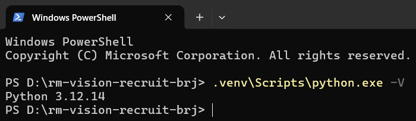

**② 包管理器归属**

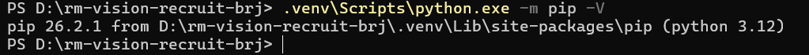

**③ 依赖安装结果**

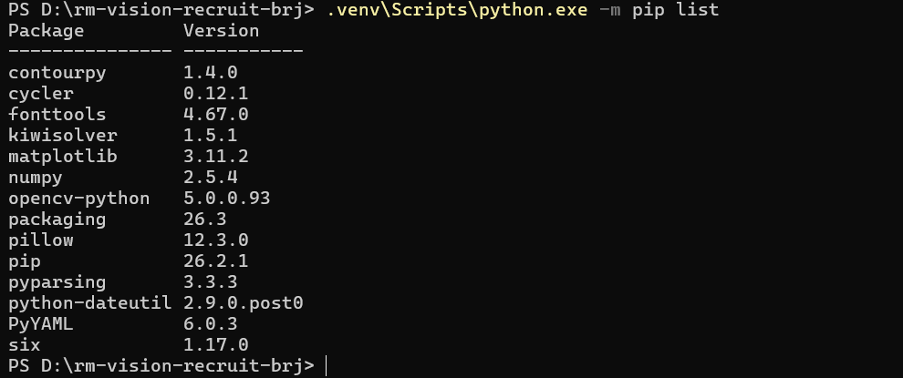

**④ 可导入性验证**

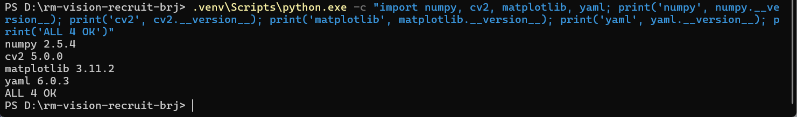

**⑤ 入库文件清单**

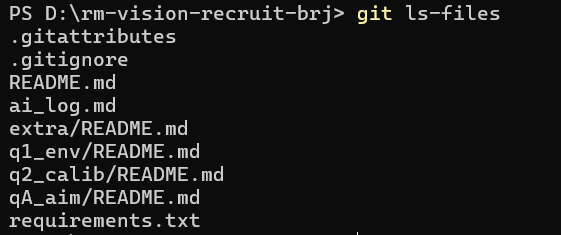

**⑥ 提交记录**

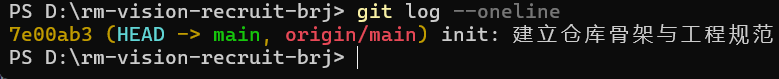

**⑦ 远程仓库页面**

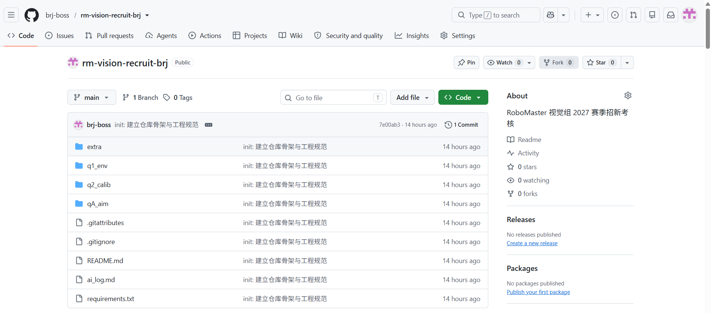

**⑧ 发挥部分：WSL2 Ubuntu 24.04**

<p>
  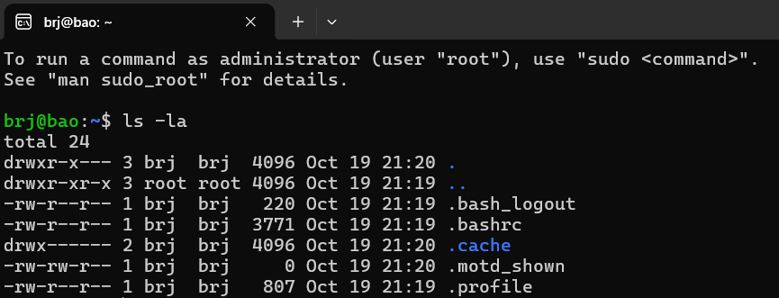
  &nbsp;
  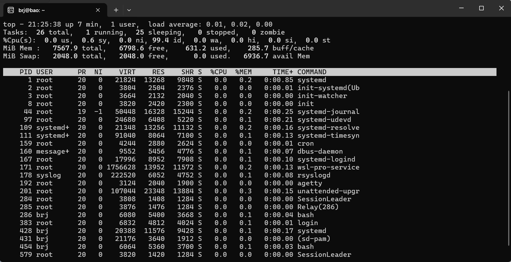
</p>
<p>
  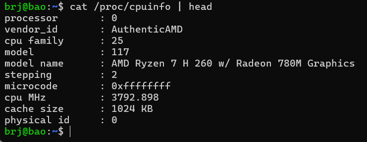
  &nbsp;
  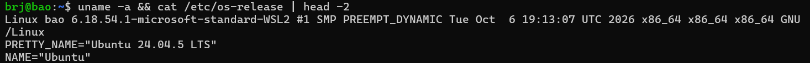
</p>

## 6. 文件组织说明

**入库的**

- 源码、说明文档、结果数据、图表与截图
- `requirements.txt`：依赖的**直接**声明，供他人一键重建

**不入库的**（见根目录 `.gitignore`）

| 路径 | 原因 |
|---|---|
| `.venv/` | 虚拟环境，可由 `requirements.txt` 重建，体积数百 MB |
| `data/` | 考核原始素材（视频、点云、地图），非本人产出；体积与仓库上限考虑 |
| `__pycache__/`、`*.pyc` | Python 字节码缓存 |
| `debug_*.png`、`tmp/` | 调试中间产物 |

> 原始素材不入库的取舍：评委 clone 后需自行放入 `data/` 才能复跑 A 题程序。
> 素材来源已在根目录 `README.md` 中说明，面试时可随机器携带。

## 7. 发挥部分：Linux 环境（WSL2 + Ubuntu 24.04）

**状态：已完成。**

### 安装方式

Windows 11 自带 WSL，无需装虚拟机软件或双系统。实际执行过程：

1. **管理员 PowerShell** 执行 `wsl --install`：自动安装 WSL 内核 3.0.3 与 `VirtualMachinePlatform` 组件，**重启电脑**生效
2. 执行 `wsl --install -d Ubuntu-24.04` 安装 Ubuntu 24.04 LTS 发行版
   > 安装时遇到的坑：分发清单从 `raw.githubusercontent.com` 拉取，直连报 `WININET_E_CONNECTION_RESET`、走代理后仍 502，最终经由其他途径完成下载安装（详见根 README 问题记录）
3. 首次启动初始化时，WSL（NAT 模式）无法使用宿主机 localhost 代理导致联网初始化卡住；执行 `wsl --shutdown` 清理后重新启动，正常完成 OOBE 流程，创建用户 `brj`

### 环境信息（`04_uname_osrelease.png`）

| 项 | 值 |
|---|---|
| 发行版 | **Ubuntu 24.04.5 LTS** |
| 内核 | **6.18.54.1-microsoft-standard-WSL2** |
| 架构 | x86_64 |
| 创建的用户 | brj（非 root，拥有 sudo） |

### 三条验证命令的实际输出

**① `ls -la`**（`01_ls_la.png`）——列出用户主目录，可见 `.bashrc`、`.profile` 等标准配置文件，用户为 `brj`

**② `top -n 1`**（`02_top.png`）——系统进程一览：26 个进程、内存 767MiB/2048MiB、负载 0.01，`systemd` 正常运行

**③ `cat /proc/cpuinfo | head`**（`03_cpuinfo.png`）——CPU 信息：AMD Ryzen 7 H 260 w/ Radeon 780M Graphics，主频 3792.898 MHz

### 截图

| 文件名 | 内容 |
|---|---|
| `screenshots/ubuntu/01_ls_la.png` | `ls -la` 输出 |
| `screenshots/ubuntu/02_top.png` | `top -n 1` 输出 |
| `screenshots/ubuntu/03_cpuinfo.png` | `cat /proc/cpuinfo \| head` 输出 |
| `screenshots/ubuntu/04_uname_osrelease.png` | `uname -a` + 发行版版本 |

### 两点体会

1. WSL2 的文件互访很直接：Ubuntu 里 `/mnt/c/` 就是 Windows 的 C 盘，反过来 Windows 资源管理器输 `\\wsl$\Ubuntu-24.04` 能进 Linux 文件系统
2. 首次初始化卡住时，先想到的是「等」和「重开」，但正确做法是 `wsl --shutdown` 彻底重启后端——这和 Windows 上处理「程序假死先重启进程」是同一个思路
